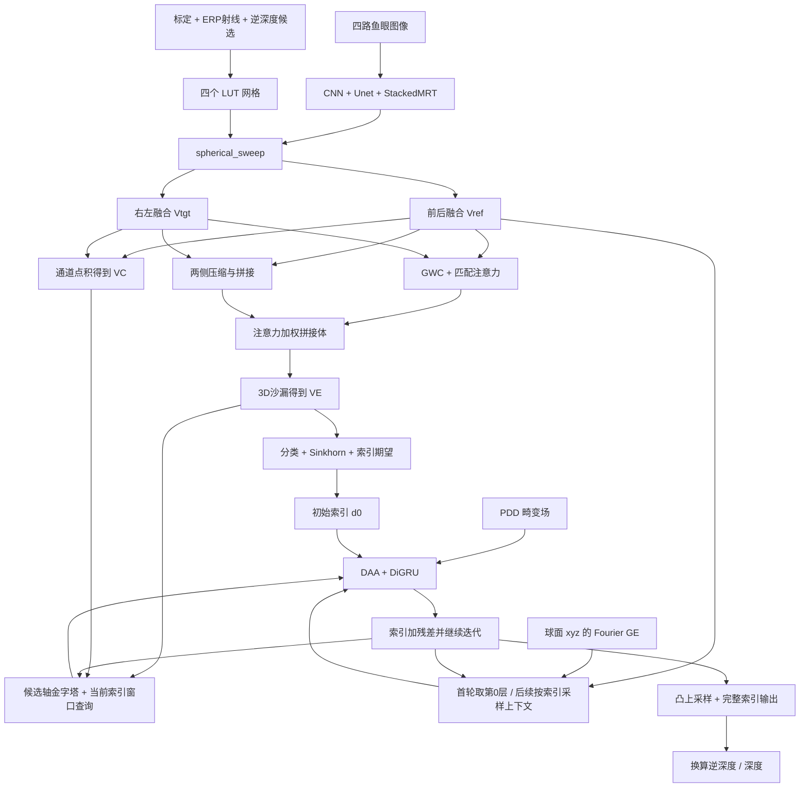

# PDF-Omni 源码阅读指南

本文对照仓库 README 链接的 [PDF-Omni 论文](https://ynskyang.github.io/pdf-omni-page/static/paper/PDF-Omni.pdf)，核对了 Fig. 2（第 5 页）、Fig. 4（第 8 页）和 §3.1–3.4。这里解释当前仓库实际执行的路径；论文的概括、代码的具体做法和两者的差别会分别说明。源码新增的是 `#` 中文注释，没有使用会改变 `__doc__` 的新文档字符串。

## 1. 先建立三个坐标域、两套索引单位

**鱼眼图像域**：每个相机自己的像素 `(u,v)`，以及编码器输出的二维特征图。四个相机此时尚未变成全景图。

**rig 球面 / ERP 域**：在相机组的共同坐标系定义射线。ERP 每个位置对应一个方向，射线上每个候选半径对应一个三维点。四相机的特征都按这个共同的 `(ERP行,ERP列,候选)` 排列，因此可以逐体素融合、比较。

**相机三维坐标域**：把共同三维点通过 `rig2cam` 变换到各个相机，再使用 OCam 多项式模型投回鱼眼图像。这里既使用旋转，也使用平移基线。

代码中的 `disp`、`invdepth`、`inv_depth` 经常只是历史变量名。网络主路径预测的是**逆深度候选的连续索引**，不是米制距离，也不是已经换算好的物理逆深度。

设完整候选数为 `N`，`K=num_downsample`，`s=2^K`：

```text
完整逆深度：rho[n] = rho_min + n * Delta_rho，n=0,...,N-1
网络候选层：使用 rho[s*d]，d=0,...,D-1，D=int(N/s)
网络内部连续索引：d
全分辨率输出索引：q，凸上采样时同时乘 s
物理逆深度：rho = rho_min + q * Delta_rho
深度：depth = 1/rho
```

索引越大表示越近。物理单位沿用数据集标定，不能仅根据 `min_depth` 的变量名推断单位。

下文用 `B` 表示批大小、`C` 表示特征通道，`Hi/Wi` 表示鱼眼原图，`Hf/Wf` 表示鱼眼特征图，`Ho/Wo` 表示输出 ERP，`H/W` 表示网络内部 ERP。不要把 `Hf/Wf` 与 `H/W` 混在一起。

## 2. 推荐阅读顺序与源码定位

表内路径相对于仓库根目录。建议先打开总前向把握调用关系，再按顺序进入模块。

| 顺序 | 文件 | 核心类 / 函数 | 阅读目标 | 论文对应 |
|---|---|---|---|---|
| 0 | [module/network.py](/Users/linzhaoxian/lzx-ws/project/PDF-Omni/module/network.py) | `PDFOmni.__init__`、`forward` | 先看 encoder、sweep、volume_gen、循环更新及返回值 | Fig. 2、§3.1 |
| 1 | [utils/dbhelper.py](/Users/linzhaoxian/lzx-ws/project/PDF-Omni/utils/dbhelper.py)、[utils/ocam.py](/Users/linzhaoxian/lzx-ws/project/PDF-Omni/utils/ocam.py) | `loadDBConfigs`、`OcamModel.setConfig` | 相机顺序、内参、多项式投影参数、外参 | §3.1 的已标定多相机前提 |
| 2 | [dataset.py](/Users/linzhaoxian/lzx-ws/project/PDF-Omni/dataset.py)、[utils/image.py](/Users/linzhaoxian/lzx-ws/project/PDF-Omni/utils/image.py) | `Dataset.loadImages`、`loadSample`、`normalizeImage` | 四路输入、灰度、归一化、GT 有效性 | Fig. 2 输入 |
| 3 | [module/backbone.py](/Users/linzhaoxian/lzx-ws/project/PDF-Omni/module/backbone.py) | `PDFOmniEncoder.forward` | 四相机拼入批次、CNN/U-Net/MRT、拆回四路 | Fig. 2 Feature Extraction |
| 4 | [module/mrt_layers.py](/Users/linzhaoxian/lzx-ws/project/PDF-Omni/module/mrt_layers.py)、[module/mrt_model.py](/Users/linzhaoxian/lzx-ws/project/PDF-Omni/module/mrt_model.py)、[module/mrt_utils.py](/Users/linzhaoxian/lzx-ws/project/PDF-Omni/module/mrt_utils.py) | `CNNEncoder`、`Unet`、`MRT`、`StackedMRT`、`BasicAttnBlock`、`GlobalAttnBlock`、`CrossAttnBlock1D/2D`、`get_pe` | 多尺度、逐行/全局注意力、相反视图配对 | §3.1 Feature Extraction |
| 5 | [dataset.py](/Users/linzhaoxian/lzx-ws/project/PDF-Omni/dataset.py) | `makeSphericalRays`、`Dataset.__initSweep`、`buildLookupTable` | ERP 方向、等间距逆深度、四个投影网格 | Fig. 2 Spherical Sweeping |
| 6 | [utils/geometry.py](/Users/linzhaoxian/lzx-ws/project/PDF-Omni/utils/geometry.py)、[utils/ocam.py](/Users/linzhaoxian/lzx-ws/project/PDF-Omni/utils/ocam.py)、[utils/image.py](/Users/linzhaoxian/lzx-ws/project/PDF-Omni/utils/image.py) | `inverseTransform`、`applyTransform`、`OcamModel.rayToPixel`、`pixelToGrid` | 三维刚体变换、鱼眼投影、归一化采样坐标 | §3.1 Spherical Sweeping 的底层实现 |
| 7 | [module/network.py](/Users/linzhaoxian/lzx-ws/project/PDF-Omni/module/network.py) | `PDFOmni.spherical_sweep` | 5D 采样、四个球面特征体及四个坐标体 | Fig. 2 Spherical Sweeping |
| 8 | [module/volume_generator.py](/Users/linzhaoxian/lzx-ws/project/PDF-Omni/module/volume_generator.py) | `MLP`、`Generator.forward` 前半段 | **重点：前后 / 右左融合与可见性行为** | §3.1 的 adaptive weighting、Vref/Vtgt |
| 9 | [module/volume_generator.py](/Users/linzhaoxian/lzx-ws/project/PDF-Omni/module/volume_generator.py) | `groupwise_corr_5d`、`ACVAttention`、`Compress3D`、`Hourglass3D` | 匹配注意力、加权拼接体、VE | Fig. 2 Attention Volume / 3D Aggregation |
| 10 | [module/volume_generator.py](/Users/linzhaoxian/lzx-ws/project/PDF-Omni/module/volume_generator.py) | `Generator._sinkhorn`、`channel_corr_5d`、`CombinedGeoEncodingSampler` | OT 初值、VC、候选轴金字塔和局部查表 | Fig. 2 OT / Soft-argmax / VL |
| 11 | [module/ge.py](/Users/linzhaoxian/lzx-ws/project/PDF-Omni/module/ge.py)、[module/network.py](/Users/linzhaoxian/lzx-ws/project/PDF-Omni/module/network.py)、[module/featurelayer.py](/Users/linzhaoxian/lzx-ws/project/PDF-Omni/module/featurelayer.py) | `GE.forward`、`_build_unit_sphere_grid`、`volume_sample`、`Conv2D` | 上下文、球面 Fourier 嵌入、隐藏状态初始化 | Fig. 2 Context / Geometry Embedding |
| 12 | [module/network.py](/Users/linzhaoxian/lzx-ws/project/PDF-Omni/module/network.py) | `PDFOmni._build_distortion_map` | 双圆盘测地距离与畸变场 | Fig. 3(b)、§3.2、式 (2)–(7) |
| 13 | [module/update.py](/Users/linzhaoxian/lzx-ws/project/PDF-Omni/module/update.py) | `ChannelAttentionEnhancement`、`DistortionAwareAttention`、`MotionEncoder`、`SelectiveConvGRU`、`DiGRU.forward` | 通道注意力、DAA、大/小核 GRU 混合、增量 | Fig. 4、§3.3、式 (8)–(9) |
| 14 | [module/network.py](/Users/linzhaoxian/lzx-ws/project/PDF-Omni/module/network.py)、[eval.py](/Users/linzhaoxian/lzx-ws/project/PDF-Omni/eval.py)、[dataset.py](/Users/linzhaoxian/lzx-ws/project/PDF-Omni/dataset.py) | `upsample_invdepth_idx`、`evaluate_dataset`、`indexToInvdepth` | 全分辨率输出、物理量换算和保存 | §3.1 Iterative Refinement、§4.2 |
| 15 | [module/loss_functions.py](/Users/linzhaoxian/lzx-ws/project/PDF-Omni/module/loss_functions.py)、[train.py](/Users/linzhaoxian/lzx-ws/project/PDF-Omni/train.py) | `lec_loss`、`sequence_loss`、`fetch_optimizer`、`train` | 初始化分布监督、迭代监督、反向传播 | §3.4、式 (10)–(16)、§4.1 |

## 3. Fig. 2 在代码中的完整数据流

下面是当前实现的调用与数据关系；`D` 是候选数量，PDD 则是空间标量场。



按论文输入 `768×800`、常用 `C=32`、`Ho×Wo=160×640`、`N=192`、`K=1`，并且空间尺寸整齐匹配时，主要形状如下。数据配置可覆盖 ERP 参数，形状应以加载后的 `data.opts` 为准。

| 数据 | 形状 | 说明 |
|---|---|---|
| `imgs[i]` | `[B,1,768,800]` 或 RGB 三通道 | 按前/右/后/左排列 |
| 编码器批次 | `[4B,3,768,800]` | 灰度复制为三通道 |
| `z0,z1,z2,z3` | `[4B,32,384,400]`、`[4B,32,192,200]`、`[4B,64,96,100]`、`[4B,64,48,50]` | 默认入口为 CNN 的 1/2 特征 |
| `fisheye_feats[i]` | `[B,32,384,400]` | MRT 只输出最终最高分辨率特征 |
| `grids[i]` | `[80,320,96,2]` | 四相机各自一份，末维为 `(u,v)` |
| `Fi` / `Gi` | `[B,32,80,320,96]` / `[B,2,80,320,96]` | 四个特征体 / 四个坐标体 |
| `front_cat` / `right_cat` | `[B,68,80,320,96]` | `2C+4`，包括两张特征和两套坐标 |
| `front_weight` / `right_weight` | `[B,1,80,320,96]` | 逐 ERP 位置、逐候选的标量权重 |
| `reference_feat` / `target_feat` | `[B,32,80,320,96]` | 配对融合后，仍保留候选轴 |
| `gwc` | `[B,8,96,80,320]` | 从此使用 Conv3d 布局 |
| `att_prob` | `[B,1,96,80,320]` | 在候选轴 softmax |
| `concat_vol` / `acv` | `[B,32,96,80,320]` | 每侧压缩到 16 通道再拼接 |
| `geo_encoding_volume` / `init_corr` | `[B,8,96,80,320]` / `[B,1,96,80,320]` | VE / VC |
| `init_prob` / `init_disp` | `[B,96,80,320]` / `[B,1,80,320]` | 初始概率 / 低分辨率索引期望 |
| `geo_feat` | `[B,324,80,320]` | `4*(8+1)*(2*4+1)`，默认 4 层、半径 4 |
| `inp` / `net` | `[B,32,80,320]` / `[B,64,80,320]` | 上下文 / 隐藏状态 |
| `motion_feat` | `[B,128,80,320]` | 127 学习通道加当前索引 |
| `distortion_map` / `att` | `[B,1,80,320]` | 固定 PDD / 逐轮学习的 DAA 权重 |
| `up_mask` | `[B,36,80,320]` | `9*s²` 个凸上采样 logits |
| 最终输出 | `[B,1,160,640]` | 完整逆深度索引，测试时裁剪到 `[0,191]` |

## 4. 多视角融合：从一个 ERP 体素开始追踪

### 4.1 为什么需要深度假设，而不是先拼四张全景图

固定 ERP 像素 `(y,x)`，`makeSphericalRays` 给出 rig 坐标系的单位方向 `r(y,x)`。对候选索引 `d`：

```text
rho_d = invdepths[s*d]
P_rig(y,x,d) = r(y,x) / rho_d
P_cam_i = R_i * P_rig + t_i
p_i = OCam_i(P_cam_i)
grid_i = (2*u_i/(Wi-1)-1, 2*v_i/(Hi-1)-1)
```

这正是 `Dataset.buildLookupTable` 的循环顺序：外层遍历候选 `d`，内层遍历相机 `i`，一次处理所有 ERP 像素。球面中心是 rig 原点，不是每个相机自己的光心。

`t_i` 使投影位置随半径改变。正确候选通常让不同相机在同一个假设三维点上采到相互兼容的特征；错误候选可能采到不同物体。因此需要保留候选轴供匹配，不能先把深度轴丢掉。

`OcamModel.rayToPixel` 使用标定的角度到半径多项式 `inv_poly`，然后做传感器仿射修正。它的局部变量 `rho` 是**图像径向像素距离**，与上式物理逆深度 `rho_d` 不同。

`pixelToGrid` 用原鱼眼大小归一化，网络在缩小特征图上复用该归一化坐标。代码没有逐卷积层校正采样中心偏移；这属于现有实现约定。

### 4.2 四个投影结果如何保存

静态 LUT 是四个 `[H,W,D,2]` 数组，二进制缓存整体为 `[4,H,W,D,2]`。`grids[i][y,x,d]` 保存**去相机 i 的哪里采样**，并不保存特征本身。

`PDFOmni.spherical_sweep` 再对每个相机取样，得到四个 `[B,C,H,W,D]` 特征体。对同一个索引 `(b,y,x,d)`，四个体都描述同一个候选三维点，只是特征来自不同相机。

这段代码使用了容易读错的 5D `grid_sample`：

```text
源特征 feat[...,None] = [B,C,Hf,Wf,1]
grid_sample 解释为    [N,C,Din,Hin,Win]
取样坐标              (0,u,v)
返回实际布局           [B,C,H,W,D]
```

因此网格前面补零是为了寻址长度为 1 的最后一轴，不是增加“零深度假设”。对于 5D 输入，默认 `bilinear` 模式执行三线性插值；由于一轴恒长为 1，实质是在鱼眼特征平面做双线性采样。

最终列表排列为：

```text
spherical_feats = [F0,F1,F2,F3,G0,G1,G2,G3]
                 [前,右,后,左, 前坐标,右坐标,后坐标,左坐标]
```

`Gi` 为 `[B,2,H,W,D]`，保留采样坐标。不同相机没有通过覆盖写入同一个体合并，而是先分别保存、随后融合。

### 4.3 如何组成 Reference / Target Volume

`Generator.forward` 的 `0::2` 和 `1::2` 是跨**整个八项列表**切片：

```text
front_cat = cat([F0,F2,G0,G2], channel)  # 2C+4 通道
right_cat = cat([F1,F3,G1,G3], channel)  # 2C+4 通道
a = reference_mapping(front_cat)      # sigmoid，1 通道
b = target_mapping(right_cat)         # 另一组独立参数，1 通道
Vref = a*F0 + (1-a)*F2
Vtgt = b*F1 + (1-b)*F3
```

两组 MLP 都是 `Conv3d(1×1×1) -> ReLU -> Conv3d(1×1×1) -> Sigmoid`。卷积核为 1，所以在每个 `(y,x,d)` 根据两相机的特征和四个坐标分量预测一个权重，不直接读取相邻 ERP 位置或邻近候选。权重在 C 个特征通道上广播。

尽管这里传入的轴顺序仍为 `[B,C,H,W,D]`，1×1×1 卷积不区分三条空间轴，逐体素 MLP 的含义不受影响；真正使用空间核的 3D 网络前会转成 `[B,C,D,H,W]`。

`Vref` 是**前后两相机融合后的球面体**，不是某一张原始前相机图；`Vtgt` 同理是右左融合后的球面体。两者覆盖同一套 ERP 与候选坐标。

### 4.4 视场重叠与不可见区域：代码实际做什么

可见性分三处理解：

1. **原始图像掩码**：`normalizeImage` 排除无效区域的统计，并将其置零。编码器之后没有再次乘原始掩码，故特征边缘不一定仍严格为零。
2. **角视场外投影**：`rayToPixel` 将超出 `max_theta` 的像素坐标置为 `-1e5`；经过归一化及 `clip(-2,1)` 后成为 `(-2,-2)`，在常用非退化特征尺寸下由 `grid_sample` 零填充。这条路径没有额外返回布尔可见性体。
3. **融合权重**：坐标也作为 MLP 输入，其中包含越界哨兵值；但融合公式没有根据布尔 mask 强制选择可见相机，也没有按有效权重重新归一化。

固定一个候选体素，可以分情况看：

| 前后两相机情况 | 实际 Vref | 含义 |
|---|---|---|
| 都有有效特征 | `a*F0+(1-a)*F2` | 学习如何在重叠区折中 |
| 只有前相机有效、后相机采样为零 | `a*F0` | 不保证 `a=1`，可能衰减 |
| 只有后相机有效、前相机采样为零 | `(1-a)*F2` | 不保证 `a=0` |
| 两侧采样均为零 | `0` | 融合本身不能生成缺失观测 |

例如 `a=0.8` 且后相机为零时，结果为 `0.8*F0`，不会自动除以 `0.8`。因此学习权重与“可见相机的严格归一化融合”应区别理解。右左组完全同理。

另一个边界细节是 `np.clip(grid,-2,1)` 不对称：正方向超出图像范围的坐标被裁到 `+1`，可能采到边界特征；负方向一般越界也并非统一强制为 `-2`。严格的零采样解释适用于上述角视场外的 `-1e5` 哨兵路径。不能将所有越界情况都笼统描述成零。

代码也没有在此用场景深度判断遮挡。一个点落在相机角视场内仍可能被前景遮挡；匹配网络需要从特征学习抑制这种不一致，不能把“角视场内”当成“真实可见”。

`Dataset.getPanorama` 的可见相机计数平均只用于显示原始图像的全景结果，**不是网络的特征融合算法**。

### 4.5 融合后怎样形成匹配证据

融合结果分为三条路径：

**VE 编码体**：

```text
Vref,Vtgt
  -> 按 C/G 分组，组内乘积取均值 -> GWC [B,G,D,H,W]
  -> 空间 patch 卷积 + 多膨胀率卷积 + 3D 沙漏 -> att_logits
  -> softmax(dim=D) -> att_prob

Vref,Vtgt
  -> 分别压缩为 16 通道并转 Conv3d 布局
  -> 拼接为 concat_vol [B,32,D,H,W]
  -> att_prob * concat_vol
  -> cost_agg 3D 沙漏 -> VE [B,8,D,H,W]
```

GWC 是组内**平均**；后面的完整通道相关是**求和**，二者并不相同。真正送入 `cost_agg` 的是注意力加权的两侧拼接特征。论文对“注意力体经 3D 聚合得到 VE”的概述没有展开这条 ACV 式分支，应以此处调用关系理解代码。

**VC 相关体**：`channel_corr_5d` 计算 `sum_c Vref[c,y,x,d]*Vtgt[c,y,x,d]`，形成 `[B,1,D,H,W]`。它保留 D 轴，求和发生在通道轴；不是在 D 上把所有候选求和，也不是像 RAFT 光流那样建立全像素四维配对表。

**上下文体**：直接令 `context_feat_volume=Vref`，仍为 `[B,C,H,W,D]`，供后续按索引采样。

## 5. 从匹配体到初始化，再进入迭代

### 5.1 OT / softargmax 初始逆深度索引

`classifier(VE)` 得到 `[B,D,H,W]` 分数；`_sinkhorn` 将其展平成 `[B,D,H*W]`，在 log 域交替归一化候选与像素两个边缘分布。目标边缘质量分别为 `1/D`、`1/(H*W)`，默认迭代 3 次。有限次迭代不意味着两个边缘都已严格收敛。

因此这一步通过共享的候选边缘分布耦合了同一张 ERP 中的不同像素。它不是将四相机做一次 OT 配对，也不是每个 ERP 像素独立 softmax。代码没有显式可调的运输温度/熵正则系数。

指数还原后，再按候选轴归一化为 `init_prob`，计算：

```text
init_disp(y,x) = sum_d init_prob[d,y,x] * d
```

这就是连续候选索引的概率期望。用于回归初值和 LEC 的 `init_prob` 来自 VE 的分类结果，**不是**前面 ACV 分支的 `att_prob`。

### 5.2 两种体如何被查询

`CombinedGeoEncodingSampler.__init__` 把 VE/VC 整理成每像素一条候选曲线，形状分别为 `[B*H*W,8,1,D]` 与 `[B*H*W,1,1,D]`。

默认 `corr_levels=4` 时，D 轴长度为 `96,48,24,12`，H/W 完全不变。每轮以 `d_t/2^level` 为中心，在该层取 `[-r,...,+r]` 共 `2r+1` 个位置，使用连续线性插值。各层窗口最后拼成 324 通道。

这里“粗到细证据”来自候选轴不同分辨率，不是将整张 ERP 不断变小。窗口越出候选范围时采用默认零填充。

### 5.3 上下文并不是一个固定的深度轴平均

`PDFOmni.forward` 的首轮流程为：

```text
context = Vref[...,0]
grid_feat = GE(unit_sphere_xyz)   # 启用 use_ge 时
context += grid_feat
inp = relu(context)
net = tanh(state_conv(context))
```

首轮使用第 0 个候选切片初始化 inp/net，即使此时已有 `init_disp` 也没有用它查询首轮上下文。`state_conv` 为 C→2C 的 1×1 卷积，默认带 BatchNorm2d，关闭该封装内部 ReLU 后外接 tanh。

从第二轮开始，`volume_sample(Vref,d_t)` 在当前低分辨率索引处插值上下文，再加相同 GE 并更新 `inp`；隐藏状态 `net` 继续从上一轮传递，不重新初始化。

`volume_sample` 原有的端点行为需留意：对 `D>1` 且索引恰好等于 `D-1`，先裁剪 floor/ceil 后计算的两权重都为零，返回零上下文。该行为只作说明，本次没有修复。

GE 的 xyz 网格独立使用 `phi∈[-pi/2,pi/2]` 和 `lam∈[-pi,pi]`，没有复用 LUT 的实际纬度裁剪及 `+pi/2` 经度偏移。它的输出可以按位置与上下文相加，但不能称为“和 LUT 完全相同的物理射线”。

## 6. Fig. 4：PDD 如何控制 DiGRU

### 6.1 固定空间先验 PDD

`_build_distortion_map` 将归一化 ERP 方形坐标压到单位圆盘内，计算式 (2) 的到圆心双曲距离。前圆盘直接使用 `(u,v)`，后圆盘使用 `((u+0.5)%1,v)`，对应半周期水平平移。

```text
df, db = 两个圆盘的测地距离
balance = 1 - abs(df-db)/(df+db+eps)     # 式 (6)，视图归属模糊程度
min_norm = tanh(min(df,db))              # 式 (5)，较优视角的径向畸变
PDD = tanh(min_norm*(1+0.5*balance))      # 式 (7)，alpha=0.5
```

它不使用图像或相机标定参数，是对 seam 几何难度的规范化空间先验，不是按每个真实镜头重新估计的光学误差场。它与候选轴 D 没有关系。

### 6.2 通道注意力与 DAA

`DiGRU.forward` 先通过 `ChannelAttentionEnhancement` 对 `inp` 进行空间全局平均/最大池化，得到 `[B,C,1,1]` 的通道权重，并计算 `inp_cam=inp*cam_w`。

`DistortionAwareAttention.forward` 再沿通道取平均和最大值，与 PDD 拼成三通道空间图：

```text
A = sigmoid(Conv7x7([mean_c(inp_cam),max_c(inp_cam),PDD]))
```

这是式 (8)。A 是学习结果，不等于 PDD，也没有硬约束保证畸变越大 A 必然越大。PDD 固定不变，但后续轮次的 `inp` 会改变，故 A 可以逐轮改变。

### 6.3 更新特征和两分支隐藏状态

`MotionEncoder` 分别编码局部 VE/VC 查询结果和当前索引，再融合为 127 通道并拼回原始索引，得到 128 通道 `motion_feat`。`gru_inp=[inp_cam,motion_feat]`，默认共 160 通道。

`SelectiveConvGRU` 使用同一个旧隐藏状态与输入计算：

```text
h_small = GRU_1x1(h_old,gru_inp)
h_large = GRU_sep(h_old,gru_inp)   # 1x7 完整门控更新，再 7x1 完整门控更新
h_new = (1-A)*h_small + A*h_large
delta_d = DepthHead(h_new)
d_new = d_old + delta_d
```

这是式 (9) 及其索引残差更新。大小分支始终都会计算，A 负责输出混合，不是动态跳过一个分支。

每轮 `d_old.detach()` 切断索引递推的梯度；隐藏状态的循环仍保留梯度。索引经 `nan_to_num` 和 clamp 的安全版本供查表与 MotionEncoder 使用，残差累加处仍使用原索引变量。

### 6.4 最后如何得到深度

`DiGRU.mask` 预测每个细像素对粗网格 3×3 邻域的权重；`upsample_invdepth_idx` 对 9 项 softmax，使用 `unfold` 取邻域，凸加权后交织子像素。默认将 80×320 恢复为 160×640，并将索引单位乘 2。

训练时保留每轮上采样结果供监督；`test_mode=True` 时只计算最后一轮上采样掩码并返回裁剪后的索引。输出分辨率是 ERP 的 160×640，不是原始鱼眼图像的 768×800。

[eval.py](/Users/linzhaoxian/lzx-ws/project/PDF-Omni/eval.py) 再调用 `data.indexToInvdepth` 换算物理逆深度。保存的浮点 TIFF 是逆深度；若要物理距离还需取倒数。点云生成使用预测距离乘 rig 射线。

## 7. 损失与训练过程

**Sequence Loss**：对所有 T 个全分辨率索引预测，在有效 GT 像素上算平均 L1，再按越晚越大的权重求和。实际 `gamma_eff=0.9^(15/T)`，第 i 轮零起始权重为 `gamma_eff^(T-i-1)`。

**LEC Loss**：输入初始化 `init_prob`，按式 (10) 计算候选概率熵并除以 `log(D)`，停止半径路径梯度，然后按式 (11) 得到 `r=max(1,ceil(H_norm*(D-1)))`。GT 空间平均降采样，valid 取块内最小值，完整索引除以 `N/D` 后四舍五入。累加 `|d-d_gt|<=r` 的概率质量 m，损失为有效区域内的 `max(0,1-m)` 均值。

高熵分布使用宽邻域，约束更宽松；均匀分布可令整个候选轴都进入邻域。因此不能把 LEC 理解为直接最小化熵，也不能把它写成对 GT 单个候选的交叉熵。函数参数 `img` 当前没有参与计算。

训练调用顺序：

1. 创建 Dataset / MultiDataset 和 DataLoader，构建或读取静态 LUT。
2. 创建 `PDFOmni`、AdamW、OneCycleLR、混合精度 GradScaler，按参数加载 checkpoint。
3. 四图前向，得到 T 个预测和初始化概率。
4. `loss=loss_seq+lec_weight*loss_lec`，默认 LEC 权重 0.1。
5. 缩放反传，反缩放后裁剪梯度，优化器更新；溢出跳过更新时也不推进调度器。
6. 每轮验证时使用 `test_mode=True`，按完整索引范围百分比统计误差，保存模型、选项和优化状态。

裸 `python train.py` 默认不启用 GE 和 DiGRU。学习完整模型应以 README 中含 `--use_ge --use_digru --ge_scale 1` 的命令为参照。推理时网络选项来自 checkpoint 内的 `net_opts`。

## 8. 论文与当前代码应区别阅读的地方

| 主题 | 论文描述 / 容易形成的理解 | 当前仓库的可核对事实 |
|---|---|---|
| 多尺度 CNN | §3.1 概括为共享 CNN 提取 2/4/8/16 倍尺度 | `CNNEncoder` 返回 2/4 倍两层，默认以 2 倍层进入 Unet，再池化到 4/8/16 倍 |
| MRT 跨注意力 | 概述未展开四相机的批次配对方式 | `chunk(2,dim=0)` 实际配前后和右左；尺度间通过上下采样和门控融合 |
| 球面假设数 | §4.1 记 N=192 | 完整轴 N=192，默认 `buildLookupTable` 实际用 D=96 层，候选索引步长为 2 |
| 参考/目标融合 | adaptive weighting 的概括可能被理解为显式可见性选择 | 两个 sigmoid MLP 直接做互补加权，没有有效性 mask 归一化；代码细节不宜由论文补猜 |
| VE 构建 | §3.1 概括为注意力体经 3D 聚合 | 还有两侧压缩拼接与候选注意力相乘的 ACV 式路径，然后再 `cost_agg` |
| 上下文 | §3.1 描述沿逆深度轴聚合成二维特征 | 首轮取第 0 层；后续在当前索引处插值；没有独立的深度轴聚合网络 |
| 圆盘压缩 | 式 (3) 在圆内保留 p | 代码圆内也乘 `(1-eps)`，并对测地距离分母与 acosh 输入加稳定性下界 |
| PDD 复用 | §3.2 说每个分辨率预计算一次 | 每次 forward 重建，在该次迭代内复用；没有跨 forward 缓存 |
| 迭代折扣 | 式 (15) 使用固定 gamma^(T-t) | 实际先将 gamma 调整为 gamma^(15/T) |
| 上采样的“输入分辨率” | §3.1 使用 input resolution 的概括说法 | 实际恢复到配置的 ERP 输出分辨率，与原鱼眼分辨率不同 |
| 普通更新分支 | 消融表中的普通 GRU 基线 | 当前 `UpdateBlock` 已有大小核混合，只是不输入 PDD；不能直接等同于表中的基线 |
| 微调时长 | §4.1 写 15 epochs | README 和 [scripts/finetune.sh](/Users/linzhaoxian/lzx-ws/project/PDF-Omni/scripts/finetune.sh) 传 16；README 另说明报告使用 epoch 14 的 checkpoint |

另有几条**源码自身的边界条件**，它们不是论文提出的新模块，也不是本次修改内容：

- 相机顺序由外部 YAML 给定，没有按朝向重排；运行前应核对四相机标定顺序。
- GE 的球面角坐标与 LUT 角坐标并不相同，详见第 5.3 节。
- 默认 `geo_ch=gwc_groups=8` 才使 Lookup 输出通道与 MotionEncoder 构造时的通道估计一致。
- `volume_sample` 的最后一个候选端点可返回零，详见第 5.3 节；Lookup 则对候选窗口越界使用零填充，两者不是同一个函数。
- `MultiDataset` 共享第一套 LUT，不随样本切换标定；LUT 缓存文件名也没有编码全部几何参数。
- `freeze_bn` 仅切换 BatchNorm2d 当前状态；训练循环随后调用 `net.train()`，并未在每轮重新冻结，也未覆盖 BatchNorm3d。

## 9. 建议用来检验理解的五个问题

1. 看到 `spherical_feats[0::2]`，能否展开为 `F0,F2,G0,G2`，并解释为什么是 68 个输入通道？
2. 对固定 ERP 像素，改变候选 d，能否沿 LUT 中的 `depth -> pts -> rig2cam -> rayToPixel` 说明四相机的采样点为什么移动？
3. 前相机可见、后相机越界且 `a=0.8` 时，能否解释输出为什么是 `0.8*F0`，而不是 `F0`？
4. 能否区分 `att_prob`、`init_prob`、DAA 的 A，以及它们分别在哪个轴归一化、控制什么？
5. 从低分辨率索引 `d=20.5` 出发，在忽略邻域差异的理想上采样情况下，能否先得到完整索引约 41，再通过 `indexToInvdepth` 得到逆深度，最后才取倒数得到距离？

## 10. 本次修改的核验范围

已完成核验：17 个 Python 文件仅新增 281 行 `#` 注释，没有删除或替换原有行。逐文件对比 Git HEAD 与工作区，抽象语法树和去除注释、空行后的 Python token 序列均一致；语法编译与 `git diff --check` 均通过。计算表达式、参数、分支、调用、导入及模型结构没有变化。

本次没有启动训练或加载数据、权重运行完整推理，也不宣称已复现论文指标。原有的 `.DS_Store` 和 `docker/` 未跟踪文件不属于本次源码学习注释改动。
